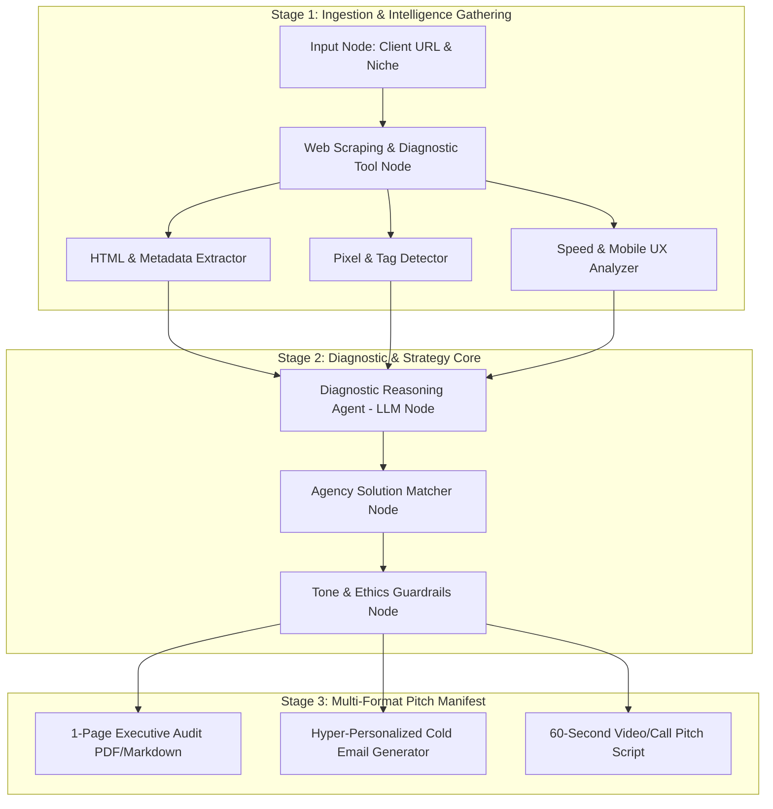
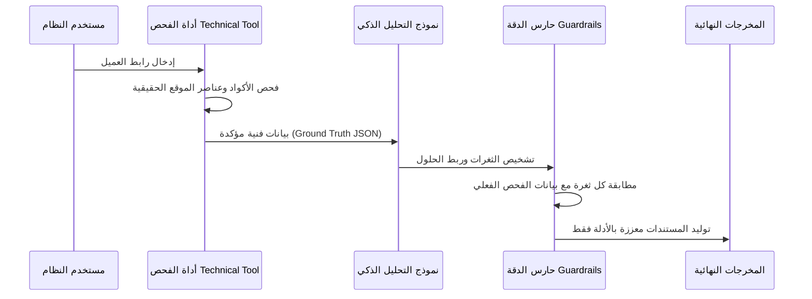

# 🏛️ الوثيقة 1: المخطط المعماري وهندسة الـ Canvas
## Project: AgencyCloser AI — Autonomous Agency Lead Auditor & Deal Closer
**Platform:** AiMicromind Canvas (Low-Code LLM Orchestration)

---

## 1. نظرة عامة على المعمارية (Architectural Overview)

يعتمد نظام **AgencyCloser AI** على معمارية وكلاء متسلسلة ومتوازنة (**Sequential Multi-Stage Agentic Pipeline**) تدمج بين استدعاء الأدوات الخارجية (**Tool Calling**)، التفكير التشخيصي المتعدد النماذج (**Diagnostic Reasoning**)، ومطابقة الخدمات بالقيمة المضافة (**Value-First Solution Matching**).

---

## 2. تفصيل العُقد على مساحة عمل AiMicromind (Canvas Node Specifications)

### 🔹 Node 1: Input & Context Ingestion (`InputNode`)
* **الوظيفة:** نقطة الدخول الأساسية للنظام لتلقي بيانات العميل المحتمل من قبل فريق المبيعات في الوكالة.
* **المدخلات (Parameters):**
  - `target_url` (String, Required): رابط موقع العميل المحتمل أو صفحته الرئيسية.
  - `business_niche` (Dropdown, Required): قطاع العميل (E-commerce, B2B SaaS, Healthcare, Real Estate, Professional Services).
  - `agency_service_focus` (Multi-select, Optional): الخدمات التي ترغب الوكالة في بيعها (Paid Ads, SEO, Conversion Optimization, Creative Production).
* **المخرجات:** كائن سياقي منظم (`LeadContextObject`).

---

### 🔹 Node 2: Web Intelligence & Technical Scanner (`ToolCallingNode`)
* **الوظيفة:** أداة كشط وفحص آمنة تقوم بفحص الصفحة الرئيسية والميتا وصفحات الهبوط للعميل دون الحاجة لأي مفاتيح خاصة بالمستخدم.
* **الأدوات المفعلة (Sub-Tools):**
  1. **Pixel & Analytics Inspector:** يبحث في كود المصدر عن علامات تتبع الإعلانات (`fbq('init')`, `gtag()`, `Google Tag Manager`, `TikTok Pixel`, `Hotjar`).
  2. **Page Speed & Mobile Core Web Vitals:** يقيس زمن التحميل الأولي وحجم الصور وحالة التجاوب مع الجوال.
  3. **Content & CTA Scanner:** يستخرج العنوان الرئيسي (H1/H2)، رسالة القيمة (Hero Value Prop)، ووضوح أزرار اتخاذ القرار (Call-to-Action Buttons).
* **المخرجات:** تقرير فني خام بصيغة JSON (`TechnicalAuditJSON`).

---

### 🔹 Node 3: Diagnostic Reasoning Agent (`LLMNode - Core Engine`)
* **الوظيفة:** تحليل الفجوات التسويقية واستخراج **أكبر 3 ثغرات تسويقية قاتلة** تتسبب في إهدار ميزانية العميل.
* **النموذج المقترح:** `Gemini 1.5 Pro` أو `Gemini 2.0 Flash` (للسرعة والدقة التحليلية العالية).
* **إعدادات المعالجة (Hyperparameters):**
  - `Temperature`: `0.2` (لضمان الدقة وتجنب الهلوسة في التحليل الفني).
  - `Top-P`: `0.9`
* **المدخلات:** `LeadContextObject` + `TechnicalAuditJSON`.
* **المنطق التحليلي:** فحص التعارضات؛ مثل وجود زيارات مع عدم وجود بكسل إعادة استهداف، أو وجود عروض قوية مع بطء شديد في صفحة الهبوط.

---

### 🔹 Node 4: Agency Solution Matcher (`Reasoning & Mapping Node`)
* **الوظيفة:** ربط كل ثغرة تسويقية تم اكتشافها بالخدمة الدقيقة التي تقدمها وكالتك، وصياغة بيان العائد المالي المتوقع (Expected ROI & Impact).
* **المنطق الاستشاري:**
  - *الثغرة:* غياب تتبع الـ Pixel $\rightarrow$ *الحل:* بناء نظام تتبع تحويلات ذكي وإعادة استهداف الزوار.
  - *الثغرة:* ضعف عنوان الصفحة الرئيسية وغياب التقييمات $\rightarrow$ *الحل:* إعادة تصميم صفحة الهبوط وتطبيق برهان اجتماعي (Social Proof & CRO).

---

### 🔹 Node 5: Tone & Policy Guardrails (`FilterNode`)
* **الوظيفة:** حارس الأمان اللغوي والأخلاقي.
* **المهام:**
  - التأكد من أن النبرة **استشارية، محترمة، وداعمة (Consultative & Value-First)**، وليست سلبية أو متعالية على العميل.
  - التحقق من عدم ذكر أي ادعاءات فنية غير مثبتة بالبيانات المفحوصة (Fact Grounding Verification).

---

### 🔹 Node 6: Multi-Format Output Manifest (`OutputNode`)
* **الوظيفة:** تحويل التحليل إلى 3 أصول مبيعات جاهزة للاستخدام الفوري:
  1. **ملف التدقيق الاستشاري (Executive 1-Page Audit):** تقرير منظم يمكن تصديره كـ PDF أو إرساله في ملف مرفق.
  2. **إيميل التواصل فائق التخصيص (Cold Outreach Email):** نص جذاب مكون من 120-150 كلمة يبدأ بملاحظة مشكلة حقيقية وينتهي بدعوة لمكالمة مجانية.
  3. **سكريبت فيديو سريع (60-Sec Loom Script):** سكريبت موجه لمسؤول المبيعات يسجل فيه شاشة الموقع ويوضح المشاكل في دقيقة واحدة.

---

## 3. مسار ربط البيانات ومكافحة الهلوسة (Data Grounding Path)

1. **الاعتماد على البيانات الصلبة فقط (Hard Data Verification):** لا يُسمح للنموذج بادعاء غياب الـ Pixel إلا إذا كانت مخرجات أداة الفحص تؤكد ذلك صراحة.
2. **عزل التقديرات عن الحقائق:** يتم التمييز بوضوح بين "الملاحظات الفنية المؤكدة" و "التوصيات التسويقية المقترحة".
