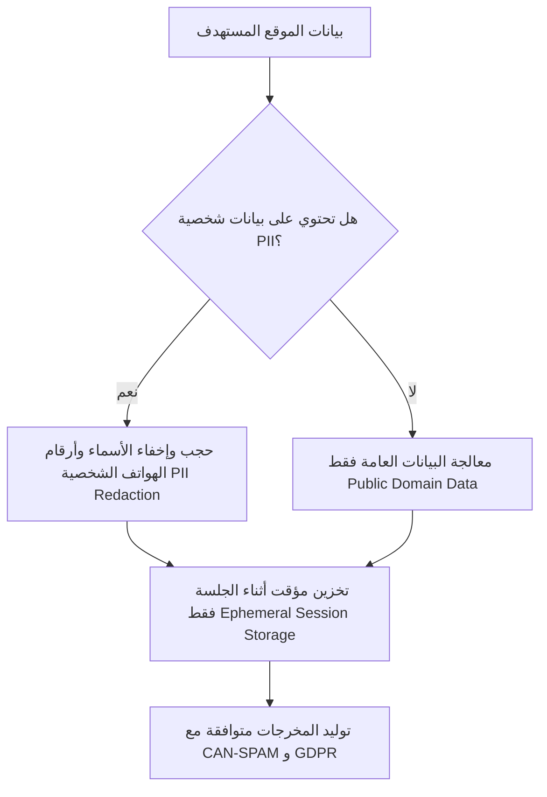

# 🛡️ الوثيقة 3: مصفوفة الحوكمة وضبط المخاطر والقيود التشغيلية
## Project: AgencyCloser AI — Autonomous Agency Lead Auditor & Deal Closer

---

## 1. قيود وحدود النظام الفنية (Technical System Limitations)

لضمان الشفافية أمام المشرفين التقنيين ولجنة التحكيم، يوضح الجدول التالي حدود النظام الحالية وكيفية معالجتها:

| القيد الفني (Limitation) | سبب القيد (Root Cause) | حل النظام والبديل الآلي (Mitigation Strategy) |
|---|---|---|
| **المواقع المبنية بـ Heavy Client-Side JS (SPAs)** | قد تتأخر بعض العناصر في التحميل عند استخدام أدوات الكشط البسيطة. | استخدام Headless Browser Renderer (مثل Playwright) مع مهلة انتظار قصيرة (Wait for DOMContentLoaded). |
| **جدران الحماية (Cloudflare / Bot Blockers)** | حظر روبوتات الكشط من الوصول المباشر للـ HTML. | تفعيل خيار **Fallback Mode**: التوليد المعتمد على الـ URL المفتوح عبر محرك البحث والـ Meta Graph المتاح دون فحص السيرفر الداخلي. |
| **البيانات المحمية بكلمات مرور (Intranets / Portals)** | عدم القدرة على فحص لوحات التحكم الداخلية للعميل. | التركيز الحصري على التجربة العامة للزائر (Public-Facing Funnel: Homepage, Product Pages, Checkout flow). |

---

## 2. حوكمة البيانات والامتثال القانوني (Data Governance & Regulatory Compliance)



### 🔒 سياسة الخصوصية وحجب البيانات الحساسة (PII Sanitization):
1. **التعامل مع البيانات العامة فقط (Public Domain Principle):** النظام يقوم فقط بفحص الأكواد والصفحات المتاحة لعامة مستخدمي الإنترنت.
2. **عزل وتشفير البيانات المؤقتة:** لا يتم تخزين تفاصيل الاتصال بالعملاء في قواعد بيانات مفتوحة، ويتم حذف السجلات المؤقتة بمجرد انتهاء جلسة التوليد على الـ Canvas.
3. **الامتثال للوائح مكافحة البريد المزعج (CAN-SPAM & GDPR Alignment):**
   - الرسائل الترويجية المقترحة مصممة كـ **رسائل استشارية مباشرة (1-to-1 Relevant B2B Inquiries)** تستند إلى أساس تجاري مشروع (Legitimate B2B Interest).
   - تشمل جميع قوالب الإيميل رابط إلغاء الاشتراك التلقائي (`opt-out`) ومعلومات الشركة المرسلة.

---

## 3. إدارة التكاليف وحصص الاستهلاك (Cost & Latency Management)

* **تكلفة المعالجة لكل عميل محتمل (Unit Economics):**
  - استدعاء أداة الفحص: مجاني (أداة سحب ويب مدمجة).
  - استدعاء نماذج الذكاء الاصطناعي (Gemini 2.0 Flash / Pro): ~2,500 Tokens لكل تقرير شامل.
  - التكلفة التقديرية لكل Lead تم تحليله: **أقل من $0.003 (أقل من نصف سنت)**.
* **الزمن المستغرق للتنفيذ (End-to-End Latency):**
  - من لحظة إدخال الرابط وحتى استلام حزمة المبيعات الكاملة: **4 إلى 7 ثوانٍ فقط**.

---

## 4. خطة معالجة الأخطاء والتعافي الذاتي (Error Handling & Fallbacks)

```markdown
IF (WebScraper_Node == TIMEOUT or FAILED):
    -> ACTIVATE Fallback_SERP_Search_Node (Search domain on Google & capture index snippet)
    -> SET Flag: "Audit Level = High-Level Structural (Due to firewall)"
    -> NOTIFY User: "Direct code scan bypassed; using public SERP intelligence."

IF (Guardrail_Node detects Aggressive/Shaming Words):
    -> TRIGGER Self-Correction Loop (Refine Prompt with strict Politeness Constraint)
    -> RE-EVALUATE text before presenting to the sales representative.
```

---

## 5. خريطة الطريق التشغيلية والمراحل القادمة (Future Operational Phases)

### 📍 المرحلة 1 (الحالية - Milestone Deliverable):
* تشغيل النظام على **AiMicromind Canvas**، استقبال الروابط يدوياً، وتوليد حزم المبيعات الثلاث (PDF + Email + Script).

### 📍 المرحلة 2 (التكامل مع أنظمة المبيعات - Month 1-2):
* ربط الـ Canvas عبر **Webhook / REST API** مع أنظمة إدارة علاقات العملاء (HubSpot / GoHighLevel / Notion).
* إنشاء إضافة متصفح (Chrome Extension) تمكّن مسؤول المبيعات من الضغط على زر واحد أثناء تصفح أي موقع ليظهر له تقرير الفحص فوراً.

### 📍 المرحلة 3 (الأتمتة الاستباقية المستقلة - Autonomous Pipeline):
* دمج وكيل بحث تلقائي يبحث في محركات البحث أو LinkedIn عن شركات ضمن مجال محدد وتنفيذ الفحص وإرسال الإيميلات بجدولة ذكية مع مراقبة تفاعل العملاء.
